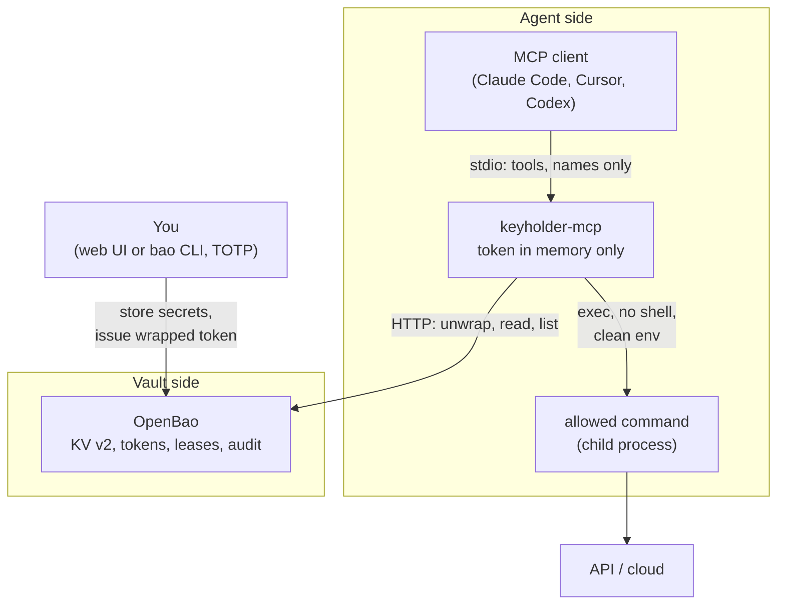
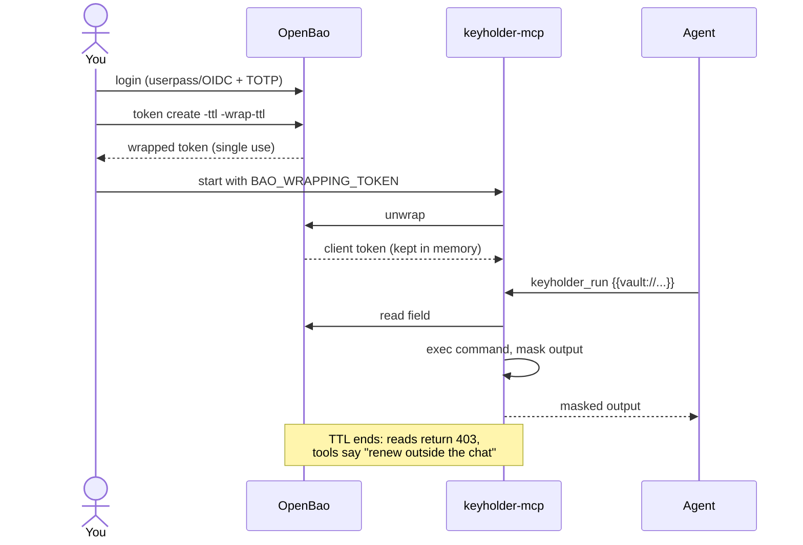

# Architecture

Keyholder builds on OpenBao instead of a vault of its own. OpenBao stores and encrypts the secrets, issues short-lived tokens, keeps leases, enforces policies, offers TOTP login and a web UI. Keyholder adds the one missing piece: an MCP server and runner that use a credential **for** the agent without returning it **to** the agent.

## Components

| Component | Origin | Role |
| --- | --- | --- |
| OpenBao | existing ([openbao.org](https://openbao.org)) | Secrets, tokens with TTL, leases, policies, TOTP, web UI, audit |
| `keyholder-mcp` | this project | MCP tools, late binding, masking, allow list, scope |
| `khcall` | this project | Debugging client and tutorial driver |

## Access flow

## Packages

| Path | Responsibility | Depends on |
| --- | --- | --- |
| `cmd/keyholder-mcp` | Reads configuration, opens the session, registers the MCP tools | everything below, MCP Go SDK |
| `cmd/khcall` | Minimal MCP client | MCP Go SDK |
| `internal/runner` | Allow list, placeholder expansion, exec without shell, environment filter, limits | `ref`, `mask` |
| `internal/bao` | OpenBao client: unwrap, KV v2 read, listing, status, clean errors | `ref`, OpenBao client |
| `internal/ref` | `vault://path/KEY` and `{{vault://...}}` parsing, scope check | standard library |
| `internal/mask` | Replaces known values with `[hidden:<ref>]` | standard library |

`internal/runner`, `internal/ref` and `internal/mask` never import OpenBao or MCP. The runner receives a `runner.Resolver` function, and only `cmd/keyholder-mcp` wires `bao.Store.Resolve` into it. A new backend (another vault, dynamic cloud credentials) is a new resolver, not a change to the runner. The code review enforces this direction (`solid#solid-d`, see [Code review](review.md)).

## Stack

| Layer | Choice | Why |
| --- | --- | --- |
| Language | Go 1.25 | One static binary per system; OpenBao itself is Go |
| MCP | [`modelcontextprotocol/go-sdk`](https://github.com/modelcontextprotocol/go-sdk) v1.8.0 | Official SDK, stdio transport |
| Vault client | [`openbao/openbao/api/v2`](https://pkg.go.dev/github.com/openbao/openbao/api/v2) v2.7.1 | Official client: unwrap, KV v2, token lookup |
| Execution | `os/exec` | Argument list, no shell |
| Vault | OpenBao, KV v2 | Open source (MPL-2.0), Linux Foundation |
