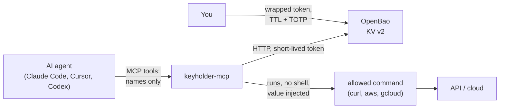

# Keyholder MCP

**Let AI agents use your credentials without ever seeing them.**

Keyholder MCP is an [MCP](https://modelcontextprotocol.io) server that sits between your AI coding agent and [OpenBao](https://openbao.org). The agent sees credential **names** and asks to run commands with them; the value is filled in only when the command runs, and the output comes back with the value masked. Access is temporary: it expires on its own.

It is free and open source (MIT): code, issues and releases at [github.com/Mpaape/keyholder-mcp](https://github.com/Mpaape/keyholder-mcp).

[Get started](getting-started.md){ .md-button .md-button--primary } [Run the quickstart](tutorials/quickstart.md){ .md-button }

## The problem

Agents need API keys, cloud credentials and tokens to do real work. Pasting them into the chat, a `.env` in the repository or a command the model writes puts them in the transcript, in logs and in places you will forget. Keyholder keeps them in the vault and gives the agent a reference instead:

```text
curl -H "Authorization: Bearer {{vault://my-project/dev/API_TOKEN}}" https://api.example.com/health
```

The agent writes the reference. Keyholder resolves it at execution time, runs `curl` without a shell, and returns:

```text
api says: hello, caller with header Authorization: Bearer [hidden:vault://my-project/dev/API_TOKEN]
```

## How it works



1. You store secrets in OpenBao, one path per project.
2. You issue a **wrapped**, single-use token with a short TTL, outside the chat.
3. `keyholder-mcp` unwraps it at startup and keeps the real token only in memory.
4. The agent lists references (`keyholder_list`) and runs allowed commands with placeholders (`keyholder_run`).
5. When the token expires, the tools fail with a clear message and you renew access outside the chat.

## What it offers

| Capability | What you get | Tutorial |
| --- | --- | --- |
| **Late binding** | `{{vault://path/KEY}}` in arguments or environment, resolved only when the command runs | [Quickstart](tutorials/quickstart.md) |
| **Masking** | Every resolved value is replaced by `[hidden:vault://...]` in stdout, stderr and errors | [Masking](tutorials/masking.md) |
| **Temporary access** | Wrapped single-use tokens, TTL, predictable failure on expiry | [Temporary access](tutorials/access.md) |
| **Project scope** | Only references under `KEYHOLDER_SCOPE` are listed or resolved | [Guardrails](tutorials/guardrails.md) |
| **Allow list** | Only named commands run, never through a shell | [Guardrails](tutorials/guardrails.md) |
| **Clean environment** | `BAO_*`, `VAULT_*` and `KEYHOLDER_*` never reach the child process | [Guardrails](tutorials/guardrails.md) |
| **Audit trail** | One stderr line per run: command, references, exit code; never values | [Configuration](configuration.md#audit-trail) |
| **Any MCP client** | Claude Code, Cursor, Codex and others over stdio | [MCP clients](clients.md) |
| **Windows, Linux, macOS** | A single Go binary; CI on the three systems | [Windows and WSL](windows-wsl.md) |

## What it does not do

Keyholder is honest about its limits, and the [security model](security.md) lists them:

- The command it runs receives the value, as any real use of a credential does.
- Masking only matches the exact value. An allowed interpreter can encode a secret and escape it; the [masking tutorial](tutorials/masking.md) shows this. That is why the allow list must never contain `sh`, `bash`, `python` or `env`.
- It does not protect against a hostile agent that runs as your own operating system user.

## Status

Proof of concept. The server, the runner and the OpenBao client work end to end and every tutorial on this site is a real, re-checked run against OpenBao 2.7.1. Dynamic AWS and GCP credentials, `keyholder_request_access` and SSH come next; see the [specification](spec.md#11-roadmap).
