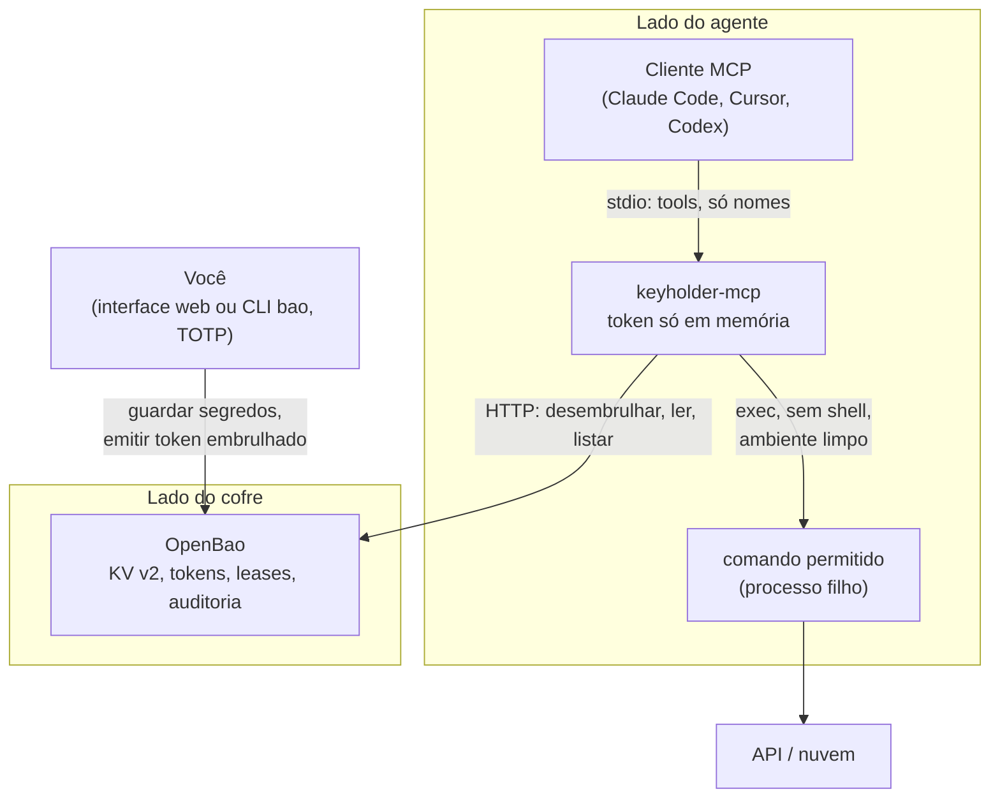
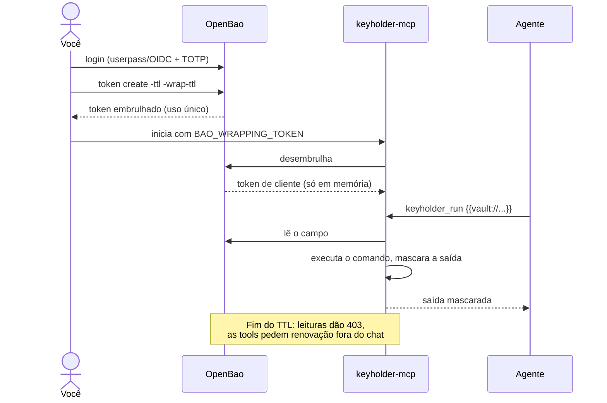

# Arquitetura

O Keyholder se apoia no OpenBao em vez de ter um cofre próprio. O OpenBao guarda e criptografa os segredos, emite tokens de curta duração, mantém leases, aplica políticas, oferece login com TOTP e uma interface web. O Keyholder acrescenta a única peça que falta: um servidor MCP e um runner que usam a credencial **pelo** agente sem devolvê-la **ao** agente.

## Componentes

| Componente | Origem | Papel |
| --- | --- | --- |
| OpenBao | existente ([openbao.org](https://openbao.org)) | Segredos, tokens com TTL, leases, políticas, TOTP, interface web, auditoria |
| `keyholder-mcp` | este projeto | Tools MCP, late binding, mascaramento, lista de comandos, escopo |
| `khcall` | este projeto | Cliente de depuração e motor dos tutoriais |

## Fluxo de acesso

## Pacotes

| Caminho | Responsabilidade | Depende de |
| --- | --- | --- |
| `cmd/keyholder-mcp` | Lê a configuração, abre a sessão, registra as tools MCP | tudo abaixo, MCP Go SDK |
| `cmd/khcall` | Cliente MCP mínimo | MCP Go SDK |
| `internal/runner` | Lista de comandos, expansão dos placeholders, exec sem shell, filtro de ambiente, limites | `ref`, `mask` |
| `internal/bao` | Cliente OpenBao: desembrulho, leitura no KV v2, listagem, status, erros limpos | `ref`, cliente OpenBao |
| `internal/ref` | Interpretação de `vault://caminho/CHAVE` e `{{vault://...}}`, checagem de escopo | biblioteca padrão |
| `internal/mask` | Troca valores conhecidos por `[hidden:<ref>]` | biblioteca padrão |

`internal/runner`, `internal/ref` e `internal/mask` nunca importam o OpenBao nem o MCP. O runner recebe uma função `runner.Resolver`, e só o `cmd/keyholder-mcp` liga `bao.Store.Resolve` a ela. Um novo backend (outro cofre, credenciais dinâmicas de nuvem) é um novo resolver, não uma mudança no runner. A revisão de código cobra essa direção (`solid#solid-d`, veja [Revisão de código](review.md)).

## Stack

| Camada | Escolha | Por quê |
| --- | --- | --- |
| Linguagem | Go 1.25 | Um binário estático por sistema; o próprio OpenBao é Go |
| MCP | [`modelcontextprotocol/go-sdk`](https://github.com/modelcontextprotocol/go-sdk) v1.8.0 | SDK oficial, transporte stdio |
| Cliente do cofre | [`openbao/openbao/api/v2`](https://pkg.go.dev/github.com/openbao/openbao/api/v2) v2.7.1 | Cliente oficial: desembrulho, KV v2, consulta ao token |
| Execução | `os/exec` | Lista de argumentos, sem shell |
| Cofre | OpenBao, KV v2 | Código aberto (MPL-2.0), Linux Foundation |
