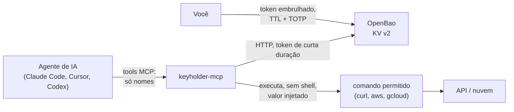

# Keyholder MCP

**Deixe agentes de IA usarem suas credenciais sem nunca vê-las.**

O Keyholder MCP é um servidor [MCP](https://modelcontextprotocol.io) que fica entre o seu agente de código e o [OpenBao](https://openbao.org). O agente vê os **nomes** das credenciais e pede para rodar comandos com elas; o valor só entra na hora de executar, e a saída volta com o valor mascarado. O acesso é temporário: expira sozinho.

É gratuito e de código aberto (MIT): código, issues e releases em [github.com/Mpaape/keyholder-mcp](https://github.com/Mpaape/keyholder-mcp).

[Começar](getting-started.md){ .md-button .md-button--primary } [Rodar o início rápido](tutorials/quickstart.md){ .md-button }

## O problema

Agentes precisam de chaves de API, credenciais de nuvem e tokens para fazer trabalho real. Colar esses valores no chat, num `.env` do repositório ou num comando escrito pelo modelo deixa a credencial na conversa, em logs e em lugares que você vai esquecer. O Keyholder mantém o valor no cofre e dá ao agente uma referência:

```text
curl -H "Authorization: Bearer {{vault://my-project/dev/API_TOKEN}}" https://api.example.com/health
```

O agente escreve a referência. O Keyholder resolve na hora de executar, roda o `curl` sem shell e devolve:

```text
api says: hello, caller with header Authorization: Bearer [hidden:vault://my-project/dev/API_TOKEN]
```

## Como funciona



1. Você guarda os segredos no OpenBao, um caminho por projeto.
2. Você emite, fora do chat, um token **embrulhado** de uso único com TTL curto.
3. O `keyholder-mcp` desembrulha o token ao iniciar e guarda o token real só em memória.
4. O agente lista as referências (`keyholder_list`) e roda comandos permitidos com placeholders (`keyholder_run`).
5. Quando o token expira, as tools falham com uma mensagem clara e você renova o acesso fora do chat.

## O que oferece

| Capacidade | O que você ganha | Tutorial |
| --- | --- | --- |
| **Late binding** | `{{vault://caminho/CHAVE}}` em argumentos ou variáveis, resolvido só na execução | [Início rápido](tutorials/quickstart.md) |
| **Mascaramento** | Todo valor resolvido vira `[hidden:vault://...]` no stdout, no stderr e nos erros | [Mascaramento](tutorials/masking.md) |
| **Acesso temporário** | Token embrulhado de uso único, TTL, falha previsível ao expirar | [Acesso temporário](tutorials/access.md) |
| **Escopo do projeto** | Só referências sob `KEYHOLDER_SCOPE` são listadas ou resolvidas | [Proteções](tutorials/guardrails.md) |
| **Lista de comandos** | Só comandos nomeados rodam, nunca por um shell | [Proteções](tutorials/guardrails.md) |
| **Ambiente limpo** | `BAO_*`, `VAULT_*` e `KEYHOLDER_*` nunca chegam ao processo filho | [Proteções](tutorials/guardrails.md) |
| **Trilha de auditoria** | Uma linha no stderr por execução: comando, referências, código de saída; nunca valores | [Configuração](configuration.md#trilha-de-auditoria) |
| **Qualquer cliente MCP** | Claude Code, Cursor, Codex e outros por stdio | [Clientes MCP](clients.md) |
| **Windows, Linux, macOS** | Um binário Go; CI nos três sistemas | [Windows e WSL](windows-wsl.md) |

## O que ele não faz

O Keyholder é honesto sobre os próprios limites, listados no [modelo de segurança](security.md):

- O comando executado recebe o valor, como em qualquer uso real de credencial.
- O mascaramento só casa o valor exato. Um interpretador liberado consegue codificar o segredo e escapar; o [tutorial de mascaramento](tutorials/masking.md) mostra isso. Por isso a lista de comandos nunca deve ter `sh`, `bash`, `python` ou `env`.
- Não protege contra um agente hostil que roda com o seu próprio usuário do sistema.

## Estado

Versão 0.1.0, a primeira [release](https://github.com/Mpaape/keyholder-mcp/releases). O servidor, o runner e o cliente do OpenBao funcionam de ponta a ponta, e todo tutorial deste site é uma execução real, reconferida, contra o OpenBao 2.7.1. Credenciais dinâmicas de AWS e GCP, `keyholder_request_access` e SSH vêm a seguir; veja a [especificação](spec.md#11-roteiro).
